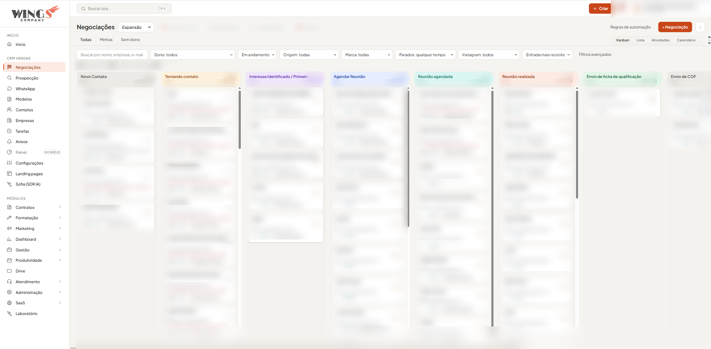
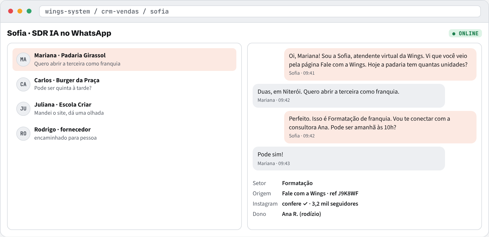
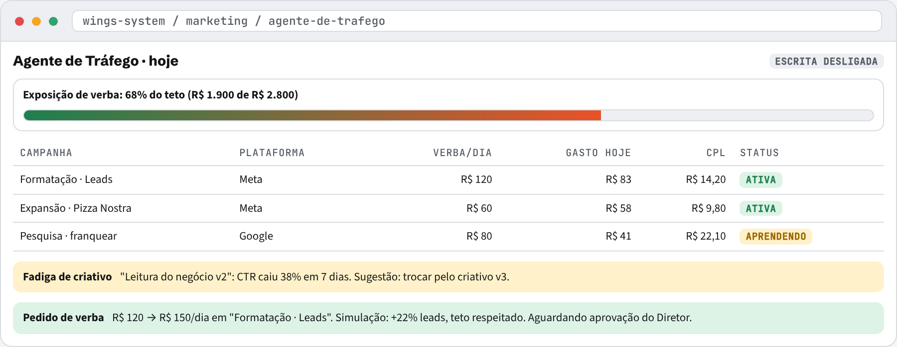
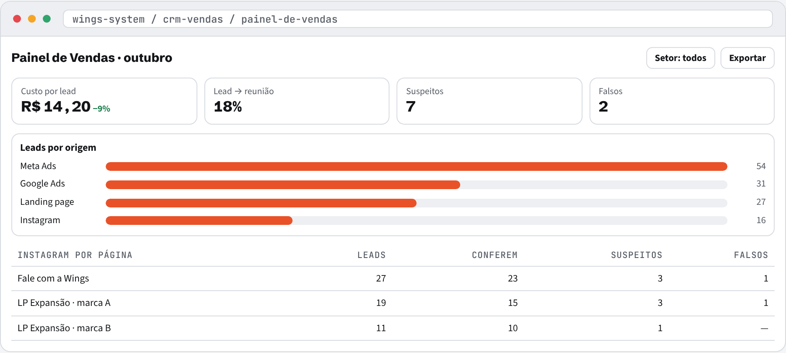
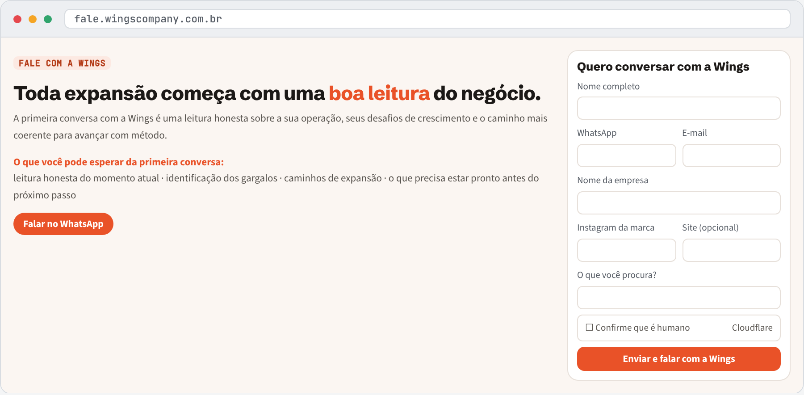
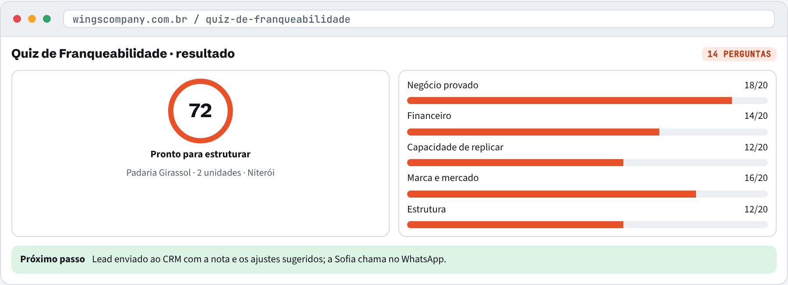
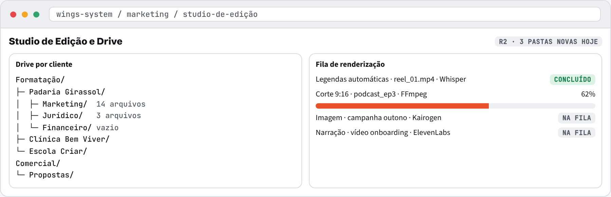
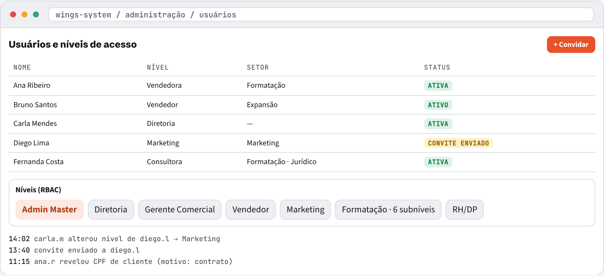
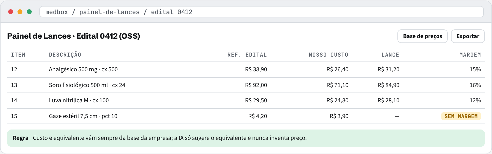

# Eric Oliveira

**Desenvolvedor Full Stack** · Engenharia de Software e Engenharia de IA · Rio de Janeiro/RJ

Construo sistemas de vendas, atendimento e marketing com agentes de IA, dentro de um método de engenharia: especificação, testes automatizados, revisão independente, CI/CD e auditorias de segurança.

[LinkedIn](https://www.linkedin.com/in/eric-oliveira-0602b396) · [Portfólio](https://claude.ai/artifact/UR1JmbcGApKsQyzfvK8Jq7)

TypeScript · JavaScript · Python · SQL · React · Node.js · PostgreSQL · Supabase · Docker · GitHub Actions · LLMs e agentes de IA

> Os repositórios dos projetos são privados. Aqui ficam só imagens das telas: na tela real os dados de clientes estão borrados, e as demais são reproduções com dados fictícios.

## Wings System

ERP/CRM multi-tenant em produção, com negociações, WhatsApp, agenda, prospecção, tráfego pago, equipe e ponto, Drive e projetos.

## Outras telas

<table>
  <tr>
    <td width="50%" valign="top"><b>Sofia, atendente de IA no WhatsApp</b> Pré-qualifica o contato e entrega ao vendedor da vez.  </td>
    <td width="50%" valign="top"><b>Agente de tráfego pago</b> Lê as contas da Meta e do Google; verba só muda com aprovação humana.  </td>
  </tr>
  <tr>
    <td valign="top"><b>Painel de vendas</b> Leads por origem e conferência do Instagram por página.  </td>
    <td valign="top"><b>Landing page de captação</b> Formulário com antirrobô, rastreamento e envio direto ao CRM.  </td>
  </tr>
  <tr>
    <td valign="top"><b>Quiz de franqueabilidade</b> Nota de 0 a 100 em cinco dimensões; o resultado vira lead no CRM.  </td>
    <td valign="top"><b>Studio de edição e Drive</b> Fila de mídia com IA e pastas por cliente.  </td>
  </tr>
  <tr>
    <td valign="top"><b>Usuários e níveis de acesso</b> Perfis por cargo, convite por e-mail e trilha de auditoria.  </td>
    <td valign="top"><b>MedBox · painel de lances</b> Cruza o edital com a base de preços, item a item.  </td>
  </tr>
</table>
